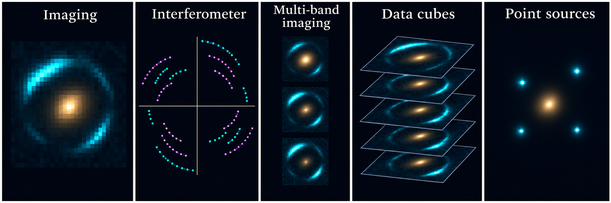
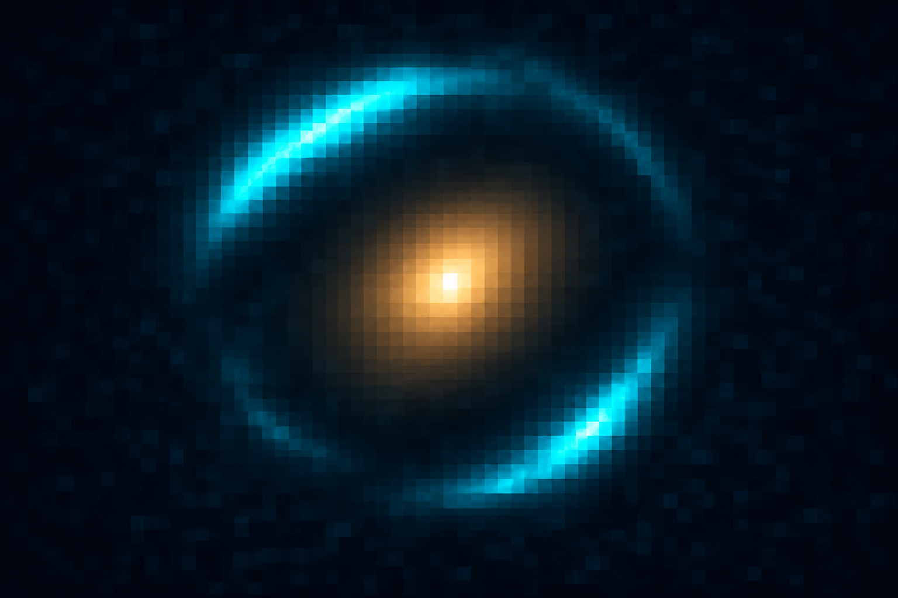
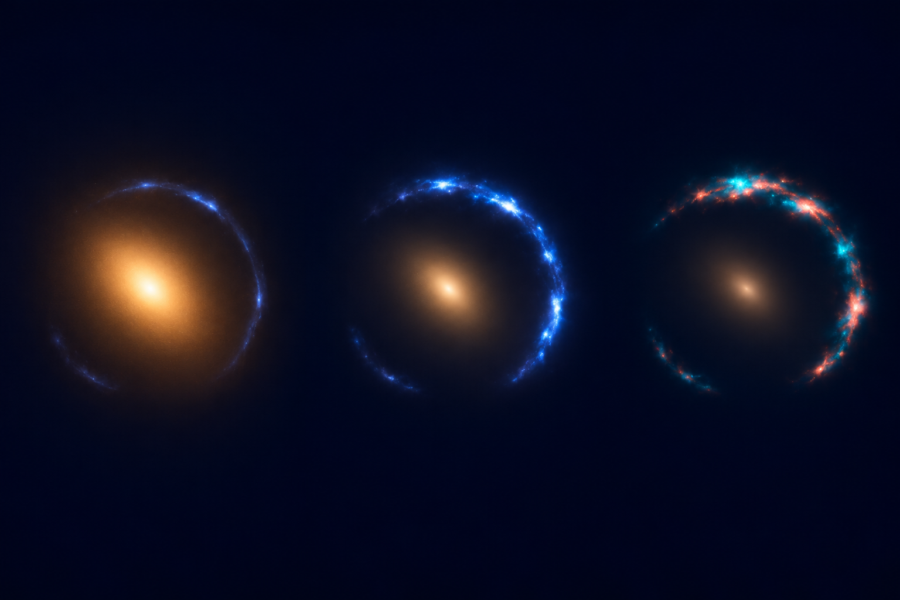
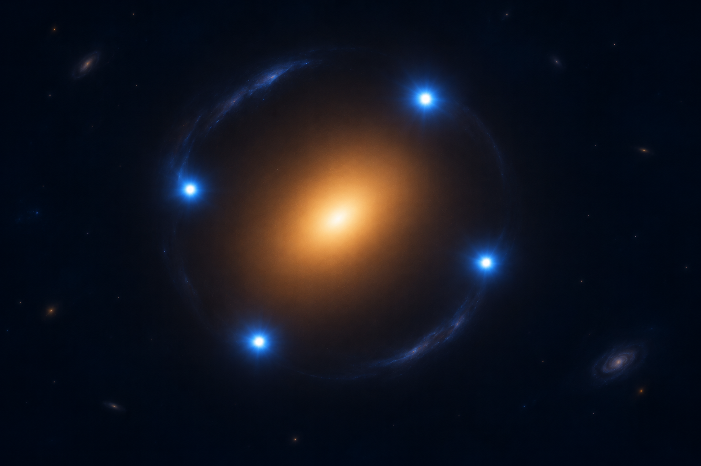
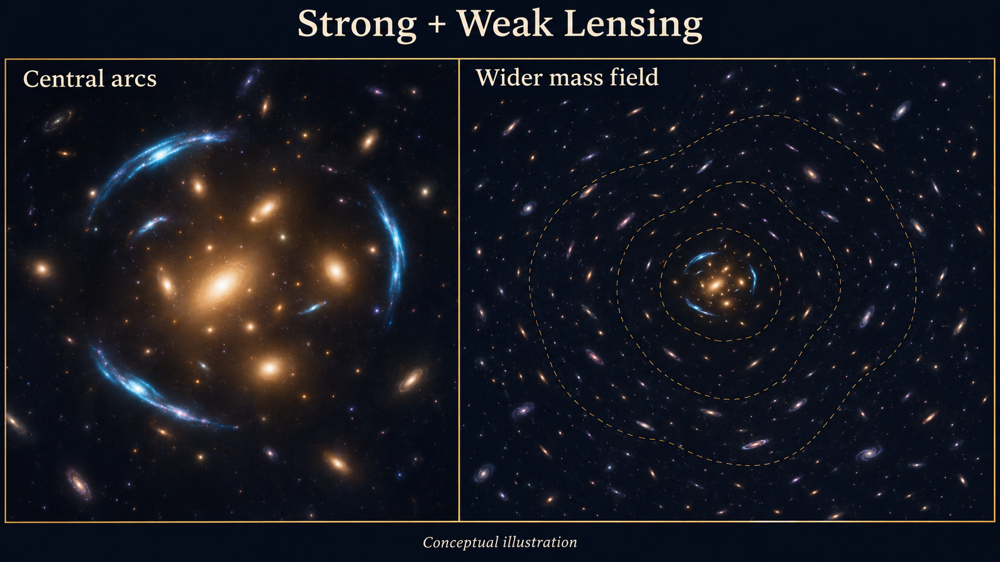

(overview-2-new-user-guide)=

# New User Guide

**PyAutoLens** models strong gravitational lenses, from individual galaxies to groups and clusters. Your starting example depends on the lens system and the observations you want to analyse.

The **autolens_workspace** contains Jupyter Notebooks that introduce the modelling workflow using example datasets, with Python code you can read, run and adapt. Start by choosing your lens scale below, then your dataset type where appropriate. You can explore an example before preparing your own data.

If you would like help along the way, describe your lens and observations to the [PyAutoLens AI Assistant](https://github.com/PyAutoLabs/autolens_assistant). It can suggest a starting notebook, explain the code and help you adapt the example to your science case.

(what-scale-lens)=

## What scale lens?

Start with the foreground objects responsible for the lensing: is the system dominated by one galaxy, several galaxies, a group or a cluster? Each route introduces a model suited to that kind of system.

These categories are a starting guide, rather than strict boundaries based on the number of galaxies. For a galaxy-scale lens, continue to the dataset choices below. The other cards take you straight to their starting notebooks.

*AI-generated conceptual illustration, not observations or a calculated lens model. Panels are not shown at the same angular scale.*

::::{grid} 1 2 2 4
:gutter: 3

:::{grid-item-card} Galaxy
Approximate Einstein radius: ~1″

One foreground galaxy dominates the lensing.

[Choose your data type below](#what-dataset-type)
:::

:::{grid-item-card} Multi-galaxy
Approximate Einstein radius: ~1–3″

Several foreground galaxies contribute significantly to the lensing.

[Notebook](https://github.com/PyAutoLabs/autolens_workspace/blob/main/notebooks/multi_galaxy/start_here.ipynb) · [Google Colab](https://colab.research.google.com/github/PyAutoLabs/autolens_workspace/blob/2026.11.12.1/notebooks/multi_galaxy/start_here.ipynb)
:::

:::{grid-item-card} Group
Approximate Einstein radius: ~3–10″

A small galaxy group lenses a background source.

[Notebook](https://github.com/PyAutoLabs/autolens_workspace/blob/main/notebooks/group/start_here.ipynb) · [Google Colab](https://colab.research.google.com/github/PyAutoLabs/autolens_workspace/blob/2026.11.12.1/notebooks/group/start_here.ipynb)
:::

:::{grid-item-card} Cluster
Approximate Einstein radius: ~10–50″

A galaxy cluster lenses multiple background sources.

[Notebook](https://github.com/PyAutoLabs/autolens_workspace/blob/main/notebooks/cluster/start_here.ipynb) · [Google Colab](https://colab.research.google.com/github/PyAutoLabs/autolens_workspace/blob/2026.11.12.1/notebooks/cluster/start_here.ipynb)
:::

::::

The **Einstein radius** gives a sense of the angular size of a lens, roughly the radius of an Einstein ring. The values above are approximate guides in arcseconds (″); real systems overlap these ranges.

About these scale estimates

These are illustrative ranges, not survey limits or predicted radii for the artwork. Multi-galaxy systems overlap galaxy and group scales. The workspace’s lensing guide uses order-one arcsecond galaxy lenses, few-arcsecond multi-galaxy/group lenses and tens-of-arcseconds cluster lenses.

Examples grounding the scale: <a href="https://www.aanda.org/articles/aa/pdf/2025/05/aa51868-24.pdf">Euclid galaxy-scale lenses</a>; <a href="https://doi.org/10.1051/0004-6361/200811473">SL2S groups with 3–8″ Einstein radii</a>; <a href="https://doi.org/10.1051/0004-6361/202349060">a cluster lens with an effective Einstein radius around 43″</a>. For a complex lens, an effective Einstein radius is often defined from the area enclosed by its tangential critical curve for a specified source redshift.

(what-dataset-type)=

## What dataset type?

For a galaxy-scale lens, choose the notebook that matches the observations you want to analyse. An image, a set of interferometer measurements and the positions of compact lensed sources each call for a different starting workflow.

Each notebook begins with example data and introduces the relevant model and fitting steps. If you do not have your own dataset yet, choose the example closest to your interests. For multi-galaxy, group or cluster systems, begin with the scale-specific guide above.

*AI-generated schematic, not measured data. The interferometer panel shows sampling locations; multi-band images show separate wavebands, while cube slices represent spectral channels.*

::::{grid} 1 2 2 2
:gutter: 3

:::{grid-item-card} Imaging

Images of extended lensed sources, from telescopes such as Hubble or JWST.

[Notebook](https://github.com/PyAutoLabs/autolens_workspace/blob/main/notebooks/imaging/start_here.ipynb) · [Google Colab](https://colab.research.google.com/github/PyAutoLabs/autolens_workspace/blob/2026.11.12.1/notebooks/imaging/start_here.ipynb)
:::

:::{grid-item-card} Interferometer

Radio or submillimetre observations, such as ALMA visibilities.

[Notebook](https://github.com/PyAutoLabs/autolens_workspace/blob/main/notebooks/interferometer/start_here.ipynb) · [Google Colab](https://colab.research.google.com/github/PyAutoLabs/autolens_workspace/blob/2026.11.12.1/notebooks/interferometer/start_here.ipynb)
:::

:::{grid-item-card} Multi-band imaging

The same lens observed in several wavebands. Fit the images together with a shared lens model using `multi_dataset/`.

[Notebook ](https://github.com/PyAutoLabs/autolens_workspace/blob/main/notebooks/multi_dataset/start_here.ipynb)·[Google Colab ](https://colab.research.google.com/github/PyAutoLabs/autolens_workspace/blob/2026.11.12.1/notebooks/multi_dataset/start_here.ipynb)
:::

:::{grid-item-card} Data cubes

Spectral-line observations across many channels, such as an ALMA CO cube.

[Notebook](https://github.com/PyAutoLabs/autolens_workspace/blob/main/notebooks/interferometer/features/datacube/start_here.ipynb) · [Google Colab](https://colab.research.google.com/github/PyAutoLabs/autolens_workspace/blob/2026.11.12.1/notebooks/interferometer/features/datacube/start_here.ipynb)
:::

:::{grid-item-card} Point sources

Multiple images of a compact source, such as a quasar or supernova.

[Notebook](https://github.com/PyAutoLabs/autolens_workspace/blob/main/notebooks/point_source/start_here.ipynb) · [Google Colab](https://colab.research.google.com/github/PyAutoLabs/autolens_workspace/blob/2026.11.12.1/notebooks/point_source/start_here.ipynb)
:::

::::

(google-colab)=

## Open and run an example

The **Notebook** links open a readable preview on GitHub. You can browse the explanations and code there before deciding which example to try.

To run an example in your browser, choose **Google Colab**. Run its setup cell first to install the software and prepare the example, then work through the notebook in order. This lets you try PyAutoLens without setting up a local installation.

If you already have PyAutoLens installed and a local copy of the workspace, open the same notebook in Jupyter on your machine. Start with the supplied dataset so you can follow the complete workflow, then adapt it to your own observations.

(weak-lensing)=

## Weak lensing

To model the subtle distortions of many background galaxies, start with [weak/](https://github.com/PyAutoLabs/autolens_workspace/tree/main/scripts/weak). You can also combine weak and strong lensing to study a cluster across both scales.

*AI-generated conceptual illustration. The panels cover different angular scales; dashed contours represent a mass model, not a direct measurement from individual galaxy shapes.*

[Notebook ](https://github.com/PyAutoLabs/autolens_workspace/blob/main/notebooks/weak/start_here.ipynb)·[Google Colab ](https://colab.research.google.com/github/PyAutoLabs/autolens_workspace/blob/2026.11.12.1/notebooks/weak/start_here.ipynb)

## Still unsure?

You do not need to settle every modelling choice before getting started. Browse the introductions to a couple of notebooks and choose the one closest to your lens and observations. The starting examples establish the workflow; more specialised choices can come later.

You can also tell the [AI Assistant](https://github.com/PyAutoLabs/autolens_assistant) what objects are in your field, what data you have and what you hope to measure. It can help you find the most relevant example.

(howtolens)=

## Learn the science

The starting examples introduce how to use PyAutoLens. If gravitational lensing or Bayesian modelling is new to you, you may also want a slower explanation of why the models and fitting methods work.

[HowToLens](https://github.com/PyAutoLabs/HowToLens) develops these ideas through worked Jupyter Notebooks. It is particularly useful for students and researchers beginning lens modelling, and you can work through it alongside the workspace examples.

If you already know the underlying science, begin with the example for your observations and return to HowToLens whenever you want more background.

(wrap-up)=

## Next steps

First, work through your chosen starting notebook and become familiar with its data, model and results. Then explore the [Features guide](https://pyautolens.readthedocs.io/en/latest/overview/overview_3_features.html) for additional modelling tools suited to your science, with links to detailed introductions and worked examples.
