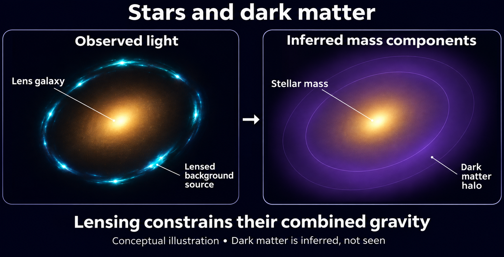
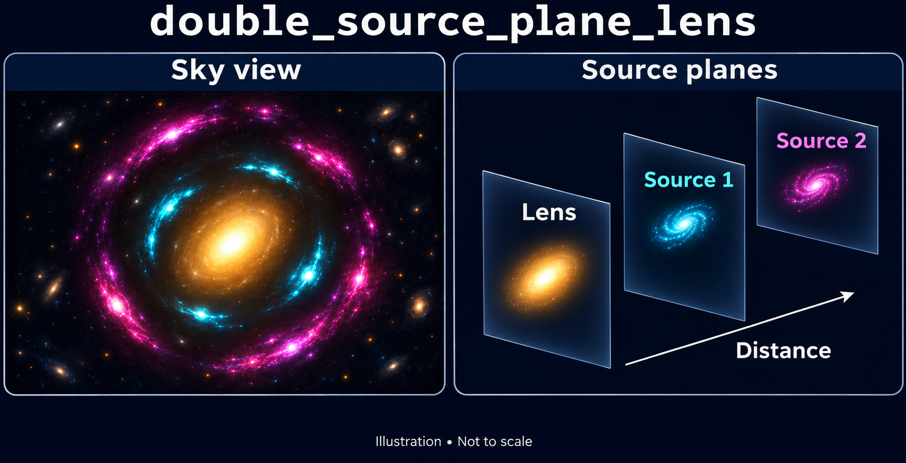
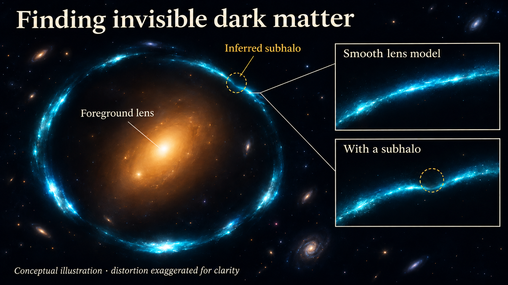
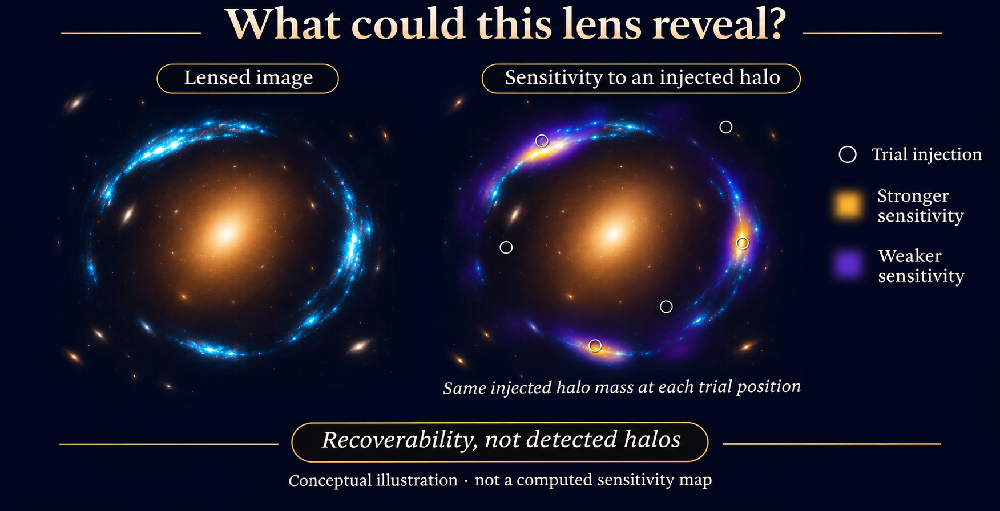
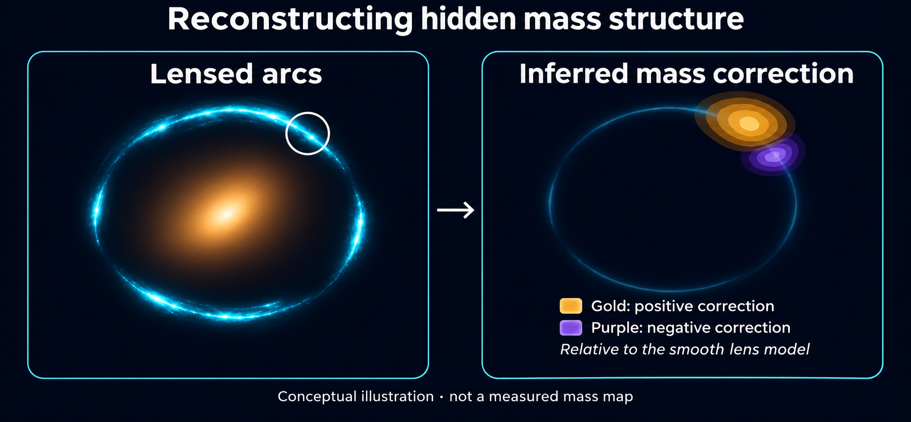

(overview-3-features)=

# Features

This page provides an overview of the advanced features of **PyAutoLens**.

Firstly, brief one sentence descriptions of each feature are given, with more detailed descriptions below including
links to the relevant workspace examples.

**Pixelizations**: Reconstructing the source galaxy on a mesh of pixels, to capture extremely irregular structures like spiral arms.

**Point Sources**: Modeling point sources (e.g. quasars) observed in the strong lens imaging data.

**Interferometry**: Modeling of interferometer data (e.g. ALMA, LOFAR) directly in the uv-plane.

**Data Cubes**: Modeling spectral-line data cubes (e.g. ALMA CO cubes), fitting every channel simultaneously with a shared lens model.

**Multi Gaussian Expansion (MGE)**: Flexible models for foreground lens light and the background source.

**Groups**: Modeling group-scale strong lenses with multiple lens galaxies and multiple source galaxies.

**Multi-Wavelength**: Simultaneous analysis of imaging and / or interferometer datasets observed at different wavelengths.

**Ellipse Fitting**: Fitting ellipses to determine a lens galaxy's ellipticity, position angle and centre.

**Shapelets**: Decomposing a galaxy into a set of shapelet orthogonal basis functions, capturing more complex structures than simple light profiles.

**Operated Light Profiles**: Assuming a light profile has already been convolved with the PSF, for when the PSF is a significant effect.

**Sky Background**: Including the background sky in the model to ensure robust fits to the outskirts of galaxies.

## Pixelizations

Recover the background galaxy behind the arcs. A pixelization reconstructs source light on a mesh, providing
flexibility to describe spiral arms, star-forming clumps and irregular structure without imposing a simple
analytic light profile.

**Study the background galaxy.** Pixelized reconstructions are a key tool for source science: investigating
galaxy structure and measuring properties such as intrinsic flux, size and lensing magnification. Start with
[source_science.py](https://github.com/PyAutoLabs/autolens_workspace/blob/main/notebooks/imaging/features/pixelization/source_science.ipynb)
to see how to analyse the reconstructed source, calculate flux and magnification, propagate uncertainties and
export the reconstruction.

```{image} images/overview_3/pixelization_illustration.png
:alt: Conceptual illustration connecting lensed arcs through a lens mass model to a source mesh and reconstructed galaxy.
:width: 100%
```

Conceptual illustration, not observational data. The mesh and galaxy on the right show the same source
brightness distribution; removing mesh lines adds no information. Reconstruction requires a lens mass model,
and the recoverable detail depends on the data and modelling assumptions.

Source brightness is solved during the fit, with regularization controlling how freely neighbouring mesh pixels
can vary. This flexibility supports both source science and lens-mass modelling; it does not remove model
degeneracies or guarantee that fine structure is real.

Read the [pixelization feature introduction](https://github.com/PyAutoLabs/autolens_workspace/blob/main/notebooks/imaging/features/pixelization/start_here.ipynb)
for use cases, mesh choices, regularization and worked examples.

For deeper teaching, see [the pixelization overview](https://github.com/PyAutoLabs/autolens_workspace/blob/main/notebooks/overview/overview_5_pixelizations.ipynb)
and Chapter 3 of [HowToLens](https://github.com/PyAutoLabs/HowToLens).

The technical model below shows an example in which the source's sampled parameter is its regularization
coefficient, while the surface brightness of the source mesh is solved during the fit.

```{image} images/overview_3/pixelization_model.png
:alt: A pixelized source lens model whose source brightness is solved during the fit.
:width: 600
```

## Point Sources

There are many lenses where the background source is not extended but is instead a point-source, for example strongly
lensed quasars and supernovae.

For these objects, we do not want to model the source using a light profile, which implicitly assumes an extended
surface brightness distribution.

Instead, we assume that our source is a point source with a centre (y,x), and ray-trace triangles at iteratively
higher resolutions to determine the source's exact locations in the image-plane:

```{image} https://raw.githubusercontent.com/PyAutoLabs/PyAutoLens/main/docs/overview/images/overview_3/point_0.png
:alt: Alternative text
:width: 400
```

```{image} https://raw.githubusercontent.com/PyAutoLabs/PyAutoLens/main/docs/overview/images/overview_3/point_1.png
:alt: Alternative text
:width: 400
```

```{image} https://raw.githubusercontent.com/PyAutoLabs/PyAutoLens/main/docs/overview/images/overview_3/point_2.png
:alt: Alternative text
:width: 400
```

```{image} https://raw.githubusercontent.com/PyAutoLabs/PyAutoLens/main/docs/overview/images/overview_3/point_3.png
:alt: Alternative text
:width: 400
```

```{image} https://raw.githubusercontent.com/PyAutoLabs/PyAutoLens/main/docs/overview/images/overview_3/point_4.png
:alt: Alternative text
:width: 400
```

The lens model this composes is drawn below: the source galaxy carries a single `al.ps.Point` component whose
`centre` is a sampled two-dimensional parameter. (Using `al.ps.PointSolved` instead solves that centre analytically
rather than sampling it.)

```{image} https://raw.githubusercontent.com/PyAutoLabs/PyAutoLens/main/docs/overview/images/overview_3/point_model.png
:alt: A point-source lens model, with an isothermal lens and a point source whose centre is sampled.
:width: 600
```

Note that the image positions above include the fifth central image of the strong lens, which is often not seen in
strong lens imaging data. It is easy to disable this image in the point source modeling.

Checkout the `autolens_workspace/*/point_source` package to get started.

## Interferometry

Modeling of interferometer data from submillimeter (e.g. ALMA) and radio (e.g. LOFAR) observatories:

```{image} https://raw.githubusercontent.com/PyAutoLabs/PyAutoGalaxy/main/paper/almacombined.png
:alt: Alternative text
:width: 600
```

Visibilities data is fitted directly in the uv-plane, circumventing issues that arise when fitting a dirty image
such as correlated noise. This uses the non-uniform fast fourier transform algorithm
\[nufftax\](<https://github.com/GragasLab/nufftax>) to efficiently map the galaxy model images to the uv-plane.

Checkout the `autolens_workspace/*/interferometer` package to get started.

## Data Cubes

Spectral-line observations produce a data cube: the same field observed in many adjacent frequency channels, so that
the source's emission-line kinematics can be studied alongside the lens model.

A cube is modeled as a list of `Interferometer` datasets, one per channel, combined into a single fit with
`af.FactorGraphModel`. Every channel shares one lens mass model, while each channel reconstructs its own source, so
the lens is constrained by the whole cube simultaneously rather than channel by channel. There is no separate cube
dataset type to learn — the existing `Interferometer` and `AnalysisInterferometer` objects are reused throughout.

Channel-invariant quantities (the lensing operator's curvature matrix) are computed once and shared across channels
rather than rebuilt per channel, which is what makes fitting a many-channel cube tractable.

Checkout the `autolens_workspace/*/interferometer/features/datacube` package to get started, which includes a
`data_preparation` example covering the conversion from a CASA-style 4D FITS cube to the inputs the fit expects.

## Multi Gaussian Expansion (MGE)

An MGE models a galaxy's light as a sum of Gaussians. In strong lensing, use it to model foreground lens light
that overlaps the arcs, or to describe the background source whose light is distorted by the lens mass model.

```{image} images/overview_3/mge_illustration.png
:alt: Illustration separating amber foreground lens light from cyan arcs, connected to the source by a lens mass model.
:width: 100%
```

Illustration, not observational data. Amber represents foreground lens light; cyan represents source light.
The lens mass model connects the source to its arcs. Gaussian components are mathematical building blocks,
not separate galaxies; the components are fitted jointly.

An MGE can capture changes in a galaxy's shape with radius that a single simple light profile misses. Its
Gaussian intensities are solved by linear algebra during fitting, rather than all being sampled separately.
This also provides a flexible smooth source model for measuring source flux and magnification.

[He et al. (2024)](https://arxiv.org/abs/2403.16253) demonstrate MGE lens-light modelling on 38 HST SLACS lenses,
combined with a pixelized source reconstruction. The workspace also includes examples using an MGE source.

MGEs can additionally connect stellar mass models to observed light, describe compact emission alongside its
host galaxy, and support deprojection of galaxy light from two dimensions to three, with appropriate assumptions.

Read the [MGE feature introduction](https://github.com/PyAutoLabs/autolens_workspace/blob/main/notebooks/imaging/features/multi_gaussian_expansion/start_here.ipynb)
for the scientific use cases, detailed teaching and worked examples.

For a technical view, the model below contains two bases of 30 Gaussians each. Their intensity parameters
are solved by the inversion rather than sampled.

```{image} images/overview_3/mge_model.png
:alt: An MGE lens model composed of two bases of thirty Gaussian components.
:width: 600
```

## Multi-Galaxy Lenses, Groups and Clusters

The strong lenses we've discussed so far have just a single lens galaxy responsible for the lensing. Above that
scale, **PyAutoLens** organises lenses into a ladder of three regimes (see the New User Guide for the full
routing): *multi-galaxy* lenses have two or more co-dominant lens galaxies and no shared dark-matter halo
(`autolens_workspace/*/multi_galaxy`); *group-scale* lenses add a group dark-matter halo as an explicit modelling
choice, with fainter members on scaling relations; and *cluster-scale* lenses keep the group's mass framework but
switch the analysis to point-source multiple-image positions of many sources. The image below shows a group-scale
system, where multiple lens galaxies deflect one or more background sources:

```{image} https://raw.githubusercontent.com/PyAutoLabs/PyAutoLens/main/docs/overview/images/overview_3/group.png
:alt: Alternative text
:width: 600
```

**PyAutoLens** has built in tools for modeling group-scale lenses, with no limit on the number of
lens and source galaxies!

Overviews of group and analysis are given in `notebooks/overview/overview_9_groups.ipynb`
The `autolens_workspace/*/group` package has example scripts for simulating datasets and lens modeling.

## Multi-Wavelength

Modeling imaging datasets observed at different wavelengths (e.g. HST F814W and F150W) simultaneously or simultaneously
analysing imaging and interferometer data:

```{image} https://raw.githubusercontent.com/PyAutoLabs/PyAutoLens/main/docs/overview/images/overview_3/g_image.png
:alt: Alternative text
:width: 600
```

```{image} https://raw.githubusercontent.com/PyAutoLabs/PyAutoLens/main/docs/overview/images/overview_3/r_image.png
:alt: Alternative text
:width: 600
```

The appearance of the strong changes as a function of wavelength, therefore multi-wavelength analysis means we can learn
more about the different components in a galaxy (e.g a redder bulge and bluer disk) or when imaging and interferometer
data are combined, we can compare the emission from stars and dust.

Checkout the `autolens_workspace/*/multi_dataset` package to get started, however combining datasets is a more advanced
feature and it is recommended you first get to grips with the core API.

### Ellipse Fitting

Ellipse fitting is a technique which fits many ellipses to a galaxy's emission to determine its ellipticity, position
angle and centre, without assuming a parametric form for its light (e.g. like a Seisc profile):

```{image} https://raw.githubusercontent.com/PyAutoLabs/PyAutoLens/main/docs/overview/images/overview_3/ellipse.png
:alt: Alternative text
:width: 600
```

This provides complementary information to parametric light profile fitting, for example giving insights on whether
the ellipticity and position angle are constant with radius or if the galaxy's emission is lopsided.

There are also multipole moment extensions to ellipse fitting, which determine higher order deviations from elliptical
symmetry providing even more information on the galaxy's structure.

The following paper describes the technique in detail: <https://arxiv.org/html/2407.12983v1>

Checkout `autolens_workspace/notebooks/features/ellipse_fitting.ipynb` to learn how to use ellipse fitting.

## Shapelets

Shapelets provide a flexible model of galaxy light beyond a single smooth profile. A key application is
source science: reconstructing the resolved morphology of a background galaxy from its lensed images.
They can also model foreground light and help test how the chosen light representation affects a lens fit.

[Birrer, Amara & Refregier (2015)](https://arxiv.org/abs/1504.07629) demonstrate lens modelling with basis
sets on RX J1131-1231. This illustrates the method rather than a PyAutoLens application.


*Conceptual illustration, not a fitted reconstruction or the exact sum of the displayed modes.*

Shapelets combine localized mathematical basis functions with linearly solved coefficients. The basis
order, scale and shared geometry control the structures a finite expansion can describe. Signed coefficients
are valid mathematical weights; negative brightness in the combined galaxy model is the physical concern.
Inspect the reconstructed light and residuals together, and test whether added flexibility follows signal
rather than noise.

The existing grid below shows individual polar basis functions. These patterns are mathematical building
blocks, not separate physical components of a galaxy:


Start with the [feature introduction](https://github.com/PyAutoLabs/autolens_workspace/blob/main/notebooks/imaging/features/advanced/shapelets/start_here.ipynb)
for scientific uses, basis construction, signed coefficients and limitations. The fit.py and modeling.py
examples show fixed-model fits, non-linear fitting, and alternative source and lens-light constructions.

## Operated Light Profiles

An operated light profile is one where it is assumed to already be convolved with the PSF of the data, with the
`Moffat` and `Gaussian` profiles common choices:

They are used for certain scientific applications where the PSF convolution is known to be a significant effect and
the knowledge of the PSF allows for detailed modeling abd deblending of the galaxy's light.

Checkout `autogalaxy_workspace/notebooks/features/operated_light_profiles.ipynb` to learn how to use operated profiles.

## Sky Background

When an image of a galaxy is observed, the background sky contributes light to the image and adds noise:

For detailed studies of the outskirts of galaxies (e.g. stellar halos, faint extended disks), the sky background must be
accounted for in the model to ensure robust and accurate fits.

Checkout `autogalaxy_workspace/notebooks/features/sky_background.ipynb` to learn how to use include the sky
background in your model.

## Mass Models

The examples above model the lens's mass with an isothermal profile, but **PyAutoLens** supports a wide
range of mass models:

Total mass profiles (e.g. the isothermal and power-law) represent the combined mass of the lens galaxy
with a single profile. Stellar + dark matter models, introduced below, separate these contributions.

Multipole perturbations (m=1, m=3 and m=4) extend any mass model with departures from elliptical symmetry, capturing
lopsidedness, boxiness / disciness and bar-like structures in the mass distribution. Accounting for this angular
complexity is critical for many science cases, as unmodeled angular structure can masquerade as other signals,
for example dark matter substructure.

The following paper measures angular mass complexity alongside dark matter substructure in JWST
strong lens imaging: <https://arxiv.org/abs/2410.12987>

The role of the m=1 multipole (lopsidedness) is detailed in: <https://arxiv.org/abs/2407.12983>

Checkout `autolens_workspace/scripts/guides/profiles` for the full range of mass profiles.

## Stellar + Dark Matter

How much of a lens galaxy's mass is in stars, and how much is dark matter? Decomposed mass models combine
the galaxy's observed light with strong lensing to infer stellar mass-to-light ratios, estimate stellar and
dark matter masses within a chosen aperture, and investigate their relative distributions.

The stellar mass follows a light model with a mass-to-light ratio; a separate halo, often described by an
NFW profile, supplies the dark matter component. Lensing responds to their combined gravity. The inferred
split therefore depends on the adopted light model, mass-to-light prescription, halo model and priors.

[Nightingale et al. (2019)](https://arxiv.org/abs/1901.07801) used PyAutoLens to investigate stellar structures
and inner dark matter halos in massive elliptical galaxies with this approach.



The image is a conceptual illustration, not a measured decomposition. The observed arcs belong to the
background source; the mass components describe the foreground lens galaxy.

Start with the [feature introduction](https://github.com/PyAutoLabs/autolens_workspace/blob/main/notebooks/imaging/features/advanced/mass_stellar_dark/start_here.ipynb)
for the science and modelling assumptions. The basic modeling example uses priors near the simulated truth;
chaining.py and slam.py demonstrate staged fits that initialize the stellar mass model from lens-light fits.


## Double Source-Plane Lenses

A double source-plane lens contains two background galaxies at different redshifts behind a foreground lens.
Their different lensing geometries let us investigate cosmological distance ratios, probe the lens mass
with two sets of arcs, and reconstruct both background galaxies for source science.

The nearer source also acts as an additional deflector for the farther source. A multi-plane model therefore
tracks both its light and its mass, using the galaxies' redshifts and the adopted cosmology to calculate the
appropriate deflections for each source.

[Collett & Auger (2014)](https://arxiv.org/abs/1403.5278) demonstrate the cosmological application using the
Jackpot lens, SDSS J0946+1006. Cosmological inference remains coupled to mass-model assumptions; the basic
modeling.py tutorial here fixes the cosmology and does not itself measure cosmological parameters.



*Conceptual illustration, not a ray-traced prediction. Colours distinguish the two sources. Double
source-plane lenses can form incomplete arcs or multiple images, rather than two complete rings.*

Start with the [feature introduction](https://github.com/PyAutoLabs/autolens_workspace/blob/main/notebooks/imaging/features/advanced/double_source_plane_lens/start_here.ipynb)
for geometry, scientific uses and inference limitations. The basic modeling example initializes priors near
the simulated truth; chaining.py and slam.py demonstrate staged fits, including the nearer source's role as
an additional lens.


## Automated Pipelines / SLaM

Fitting complex lens models (e.g. a decomposed mass model with a pixelized source) in one non-linear search is
often infeasible: the parameter space is too complex for the fit to converge reliably or efficiently.

Search chaining breaks the fit into a sequence of simpler searches, where the results of each search initialize
the model of the next. The Source, Light and Mass (SLaM) pipelines are **PyAutoLens**'s pre-built implementation
of this approach: they first build a robust model of the source, then the lens's light, and finally its mass,
gradually increasing model complexity. The SLaM pipelines have been used in many published **PyAutoLens** analyses
and are the recommended way to perform detailed lens modeling of large samples.

Checkout `autolens_workspace/*/guides/modeling/slam_start_here.py` to get started with the SLaM pipelines.

## Dark Matter Subhalos

Small dark matter halos can perturb the shapes of lensed arcs even when they contain too little starlight to
be seen directly. **PyAutoLens** searches for these otherwise invisible structures by fitting lens models with
and without an additional halo, comparing their Bayesian evidence and inferring the candidate's position and mass
under the adopted halo model.

Use this feature to search for candidate subhalos, investigate arc anomalies, and build detection results for
population studies of dark matter. Pair it with **sensitivity mapping**: simulated halos of different masses and
positions establish what a dataset could detect, making non-detections scientifically informative too.



*Conceptual illustration, not observational data. The distortion is exaggerated for clarity; the dashed marker
represents an inferred halo position, not light emitted by dark matter.*

An evidence increase is conditional on the lens and source models being compared. Candidates require checks of
the main lens mass distribution, source reconstruction and observational systematics. A halo along the line of
sight can also perturb an arc; this example models the perturber at the lens redshift.

For a scientific application and the importance of testing lens-model flexibility, see
[Nightingale et al., Scanning For Dark Matter Subhalos in Hubble Space Telescope Imaging of 54 Strong Lenses](https://arxiv.org/abs/2209.10566).

Start with the [subhalo detection introduction](https://github.com/PyAutoLabs/autolens_workspace/blob/main/notebooks/imaging/features/advanced/subhalo/detect/start_here.ipynb)
for the SLaM workflow, grid search and evidence interpretation, then explore
[sensitivity mapping](https://github.com/PyAutoLabs/autolens_workspace/blob/main/notebooks/imaging/features/advanced/subhalo/sensitivity/start_here.ipynb).

## Sensitivity Mapping

**What could this lens have revealed, even when no subhalo was found?**

Sensitivity mapping measures which dark matter halos a dataset and modeling procedure could detect. It injects
halos into simulated observations, fits each simulation with and without a halo, and compares the Bayesian evidence.
This calibrates both detections and non-detections, enabling population studies of the abundance and masses of
small halos when combined with a halo-population model.

Use it to interpret a non-detection or compare the reach of different observations. Additional simulations with
changed noise levels or angular resolution can help assess observing strategies; the introductory example does
not perform that comparison.



*Conceptual illustration, not a computed sensitivity map. The overlay depicts recoverability at one illustrative
injected mass, not detected halos or the four-cell result of the introductory script.*

Start with [sensitivity mapping](https://github.com/PyAutoLabs/autolens_workspace/blob/main/notebooks/imaging/features/advanced/subhalo/sensitivity/start_here.ipynb):
a demonstration with an MGE source, four injected positions and one fixed injected halo mass. Each simulated dataset
is fitted twice. The recovery fits allow mass to vary and use narrow position priors around each injected location.
For calibration using reconstructed source morphology, see
[slam_source_pixelized.py](https://github.com/PyAutoLabs/autolens_workspace/blob/main/notebooks/imaging/features/advanced/subhalo/sensitivity/slam_source_pixelized.ipynb).

Sensitivity depends on the simulation, priors, model family and detection threshold. Calibrate it consistently with
the detection analysis; a positive evidence difference alone is not sufficient to claim recovery. A population
analysis needs more than this small demonstration.

For the scientific connection between detection limits and substructure population constraints, see
[Vegetti & Koopmans (2009)](https://arxiv.org/abs/0903.4752).

## Potential Correction

**What mass structure is your smooth lens model missing?**

Potential correction, also called gravitational imaging, reconstructs small changes to the lensing potential on a
pixelized mesh while reconstructing the background source. Use it to investigate coherent arc residuals, locate
candidate mass perturbations for subsequent physical modeling, and explore departures from a simple smooth lens
model without first choosing a particular halo density profile.



*Conceptual illustration, not a measured mass map. Positive and negative corrections mean more or less projected
mass relative to the smooth baseline; a negative correction does not mean negative total mass.*

A reconstructed feature is not by itself a confirmed dark-matter detection. Its interpretation depends on the
main lens model, source reconstruction, mask, mesh and regularization, as well as observational systematics.
Potential correction reconstructs structure for the dataset being fitted; sensitivity mapping instead measures
recovery across injected perturbations.

For a scientific application, [Powell et al. (2025)](https://www.nature.com/articles/s41550-025-02651-2) uses
very-high-resolution radio observations of JVAS B1938+666. This illustrates the method's reach, not a mass-detection
limit promised by the introductory imaging example. The PyAutoLens implementation credits the
[Cao et al. potential-correction software](https://github.com/caoxiaoyue/lensing_potential_correction);
retain its [citation and reproduction materials](https://github.com/caoxiaoyue/potential_correction_paper) when using it.

Start with the [potential correction introduction](https://github.com/PyAutoLabs/autolens_workspace/blob/main/notebooks/imaging/features/advanced/potential_correction/start_here.ipynb)
for simulated imaging with a known smooth starting model, joint reconstruction, convergence corrections,
iterative refinement and evidence sampling. Continue to the
[likelihood walkthrough](https://github.com/PyAutoLabs/autolens_workspace/blob/main/notebooks/imaging/features/advanced/potential_correction/likelihood_function.ipynb)
or the [interferometer example](https://github.com/PyAutoLabs/autolens_workspace/blob/main/notebooks/interferometer/features/advanced/potential_correction/start_here.ipynb).

## Graphical Models

The examples above fit each strong lens dataset one-by-one. However, many lens properties are shared across a
sample (e.g. population-level mass distributions, cosmological parameters), and fitting lenses independently does
not exploit this shared structure.

Graphical models fit multiple datasets simultaneously, explicitly defining which parameters are unique to each
lens and which are shared across the sample. For example, the Hubble constant can be inferred jointly from many
time-delay lenses, with each lens having its own mass model but all sharing a single H0. Hierarchical extensions
assume parameters are drawn from a parent distribution (e.g. the population's distribution of mass slopes), whose
properties are inferred from the full sample, extracting significantly more information than one-by-one fitting.

Checkout `autolens_workspace/*/guides/modeling/advanced/graphical.py` to learn how to fit a graphical model
and `autolens_workspace/*/guides/modeling/advanced/hierarchical.py` for hierarchical models.

## Weak Lensing

In the weak lensing regime, a foreground mass distribution (e.g. a galaxy cluster) subtly distorts the shapes of
many background galaxies, coherently aligning their ellipticities, without producing the multiple images and
giant arcs of strong lensing.

**PyAutoLens** fits weak lensing shear catalogues using the same mass profiles and non-linear search tools as
strong lensing: model-independent mass maps, parametric halo model fits and tangential shear profiles. Its
quickstart example fits the real JWST-era shape catalogue of Abell 2744, and strong and weak lensing data can
be combined in joint analyses of the same cluster.

Checkout `autolens_workspace/*/weak/start_here.py` to fit your first weak lensing dataset.
