(overview-3-features)=

# Features

Explore the modelling tools you can add to your analysis. Each introduction explains the scientific use cases and links to worked examples.

For your first dataset and starting notebook, use the [New User Guide](https://autolens.readthedocs.io/en/latest/overview/overview_2_new_user_guide.html).

<table class="feature-gallery"><tbody><tr><td width="25%"><a href="#pixelizations">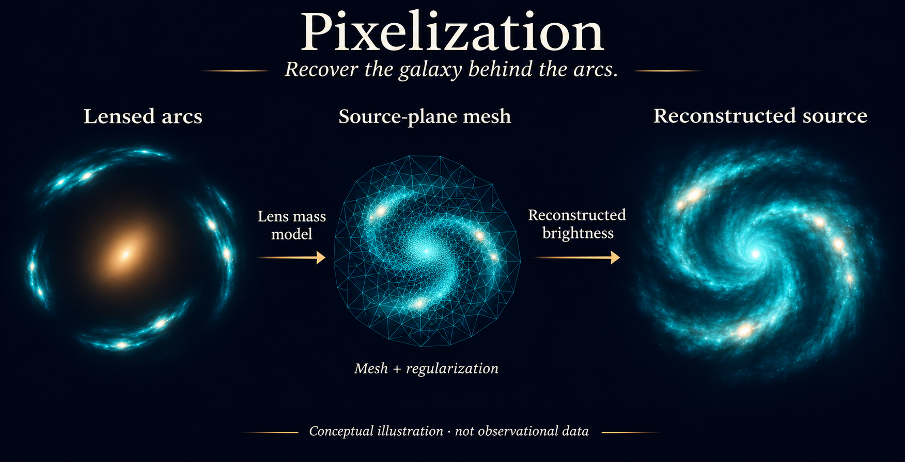 Pixelizations</a></td><td width="25%"><a href="#multi-gaussian-expansion-mge">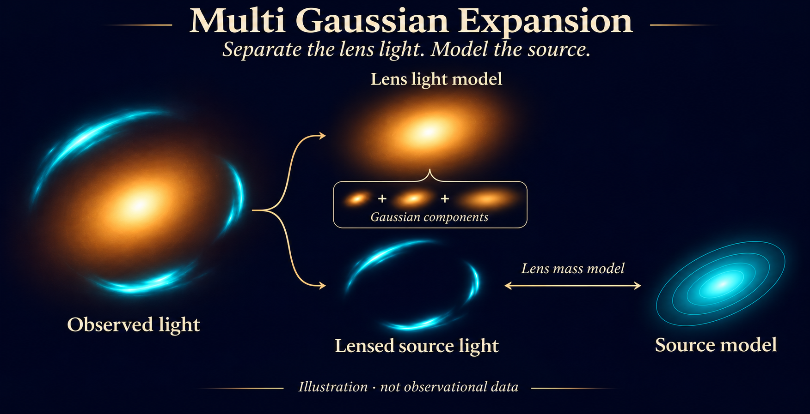 MGE</a></td><td width="25%"><a href="#dark-matter-subhalos"> Dark Matter Subhalos</a></td><td width="25%"><a href="#sensitivity-mapping"> Sensitivity Mapping</a></td></tr></tbody></table>

*Conceptual illustrations, not measured data or guaranteed reconstructions.*

More feature illustrations
<table class="feature-gallery"><tbody><tr><td width="25%"><a href="#shapelets">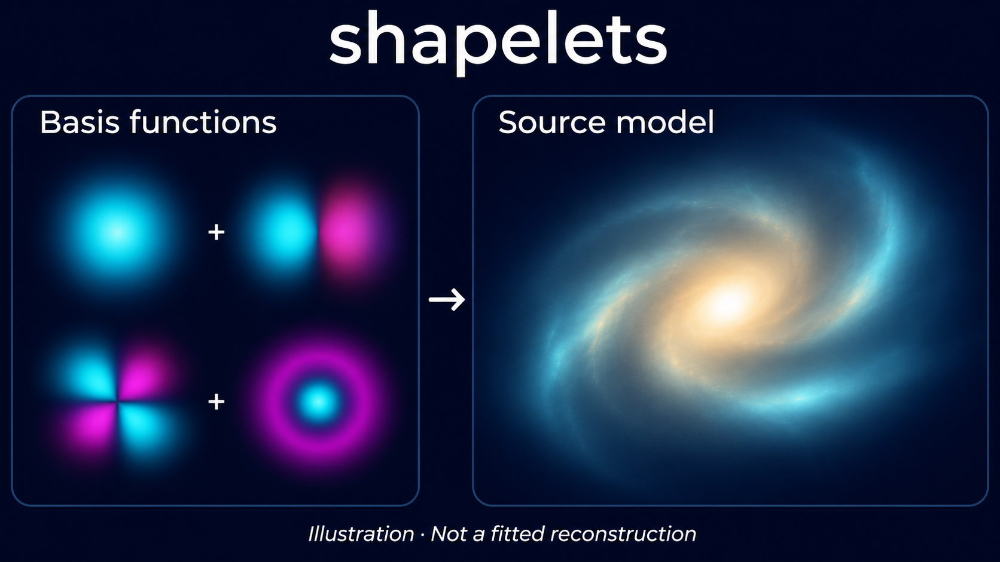 Shapelets</a></td><td width="25%"><a href="#point-sources">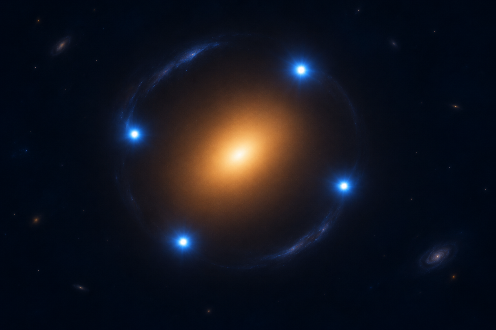 Point Sources</a></td><td width="25%"><a href="#interferometry">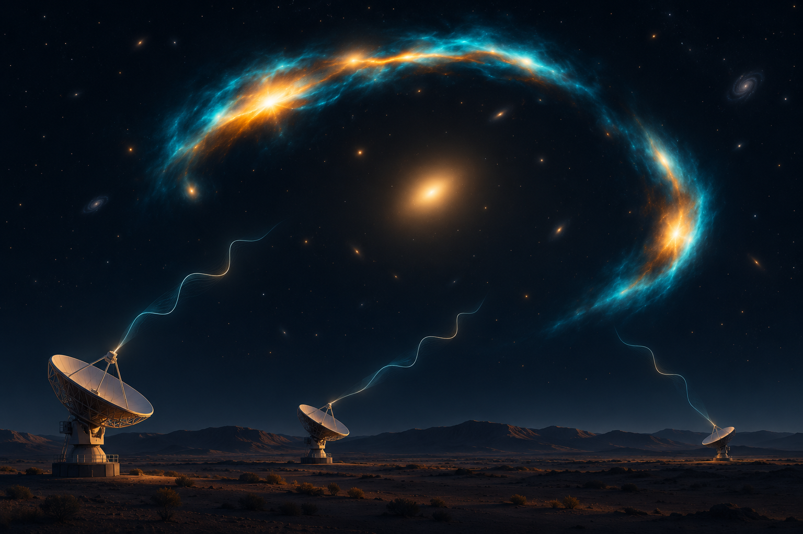 Interferometry</a></td><td width="25%"><a href="#data-cubes">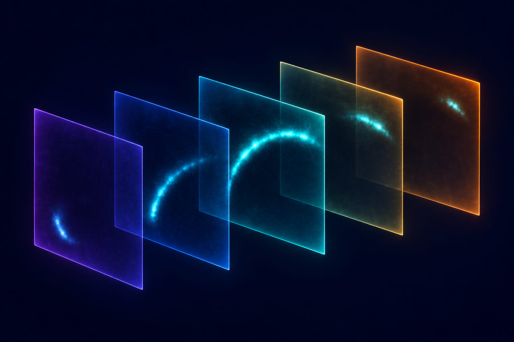 Data Cubes</a></td></tr><tr><td width="25%"><a href="#multi-wavelength">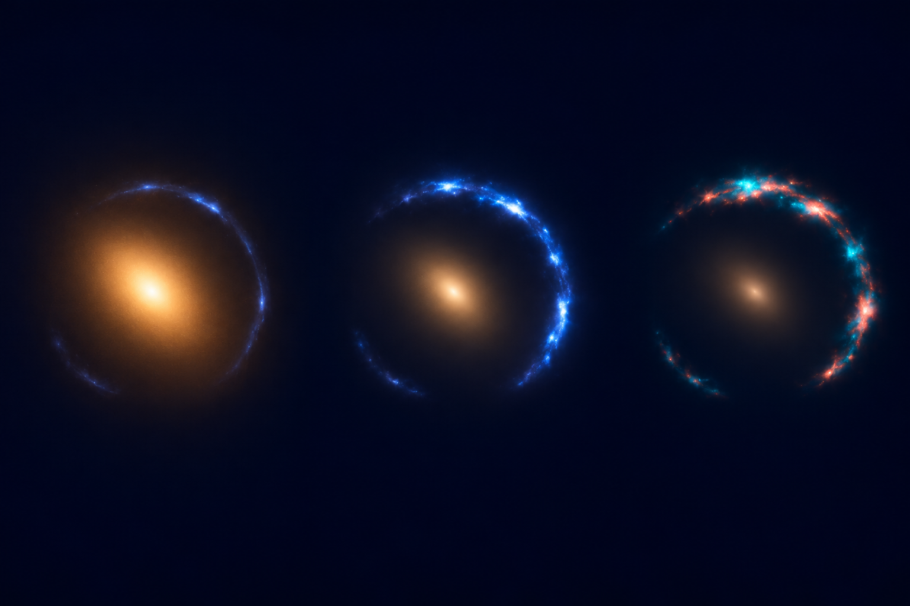 Multi-Wavelength</a></td><td width="25%"><a href="#linear-light-profiles">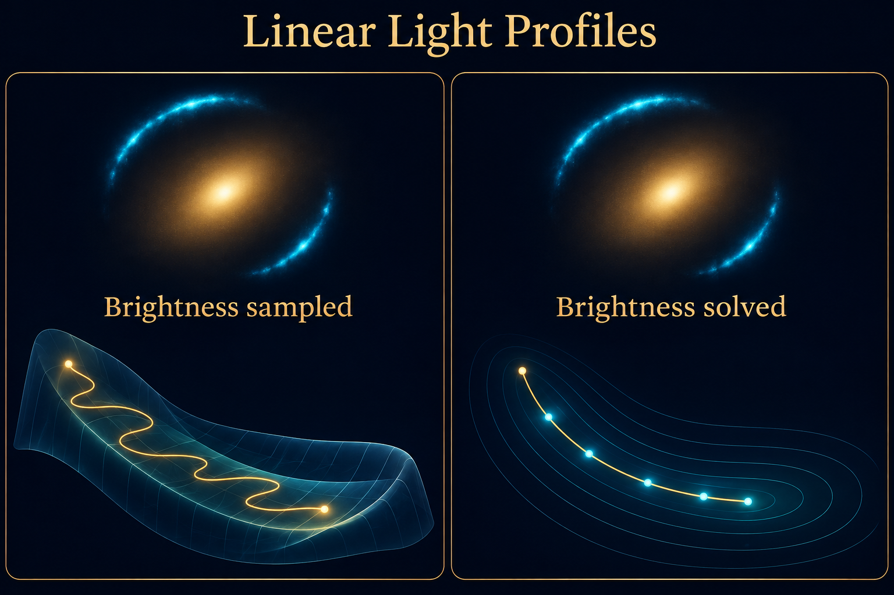 Linear Light Profiles</a></td><td width="25%"><a href="#extra-galaxies">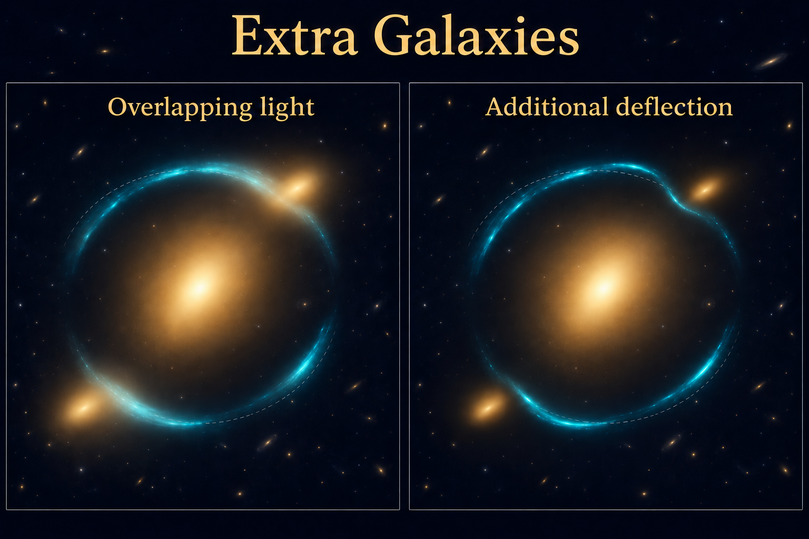 Extra Galaxies</a></td><td width="25%"><a href="#no-lens-light">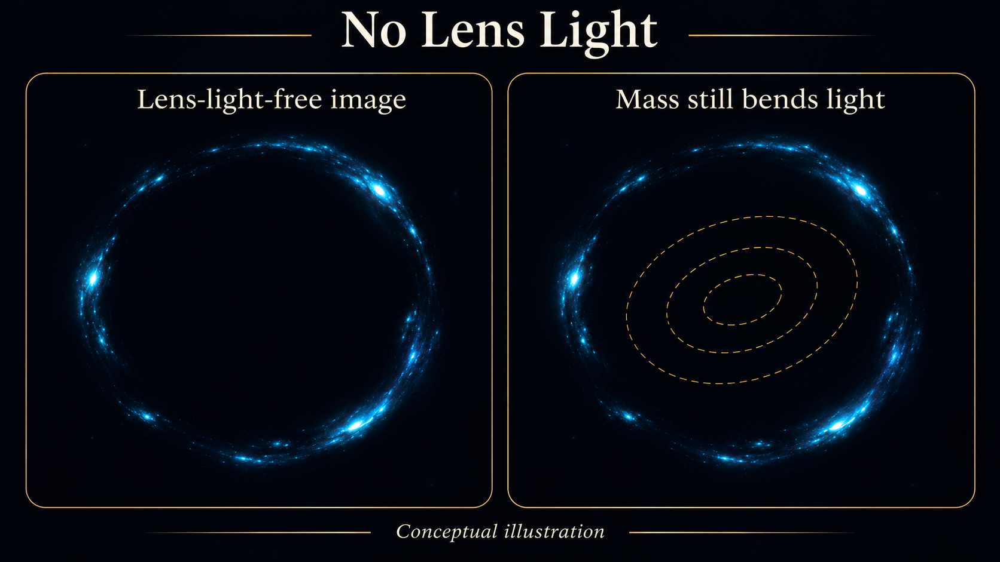 No Lens Light</a></td></tr><tr><td width="25%"><a href="#operated-light-profiles">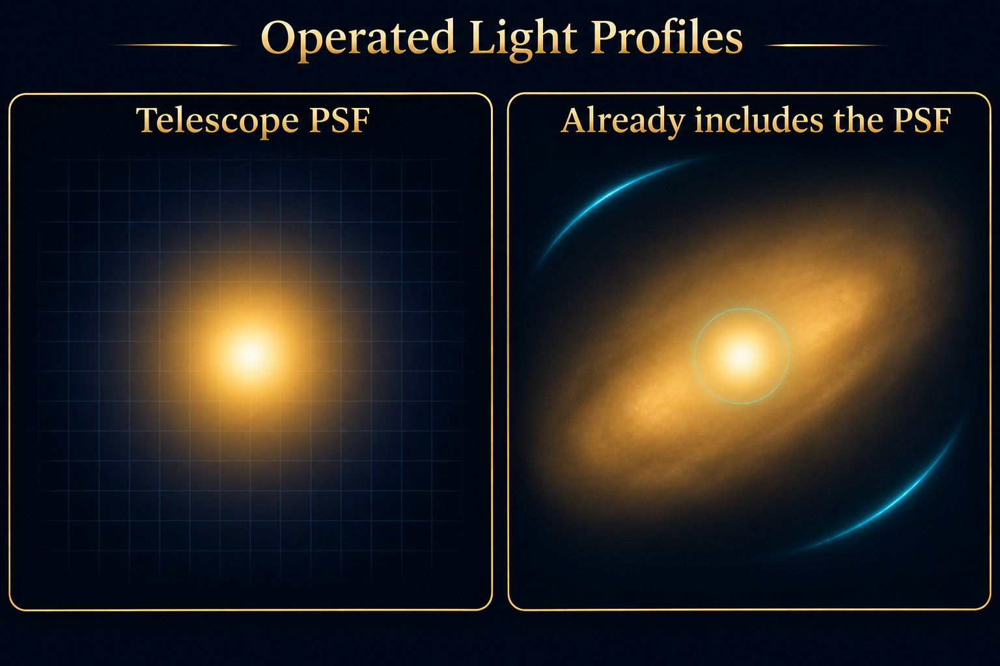 Operated Light Profiles</a></td><td width="25%"><a href="#sky-background">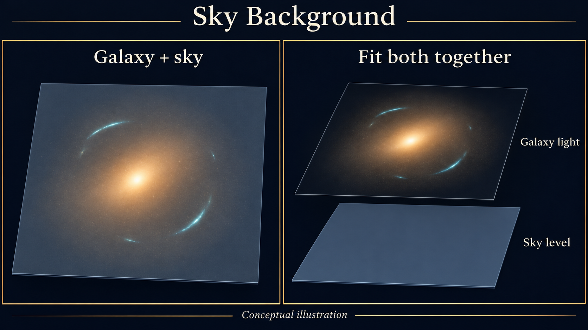 Sky Background</a></td><td width="25%"><a href="#stellar-dark-matter"> Stellar + Dark Matter</a></td><td width="25%"><a href="#scaling-relations">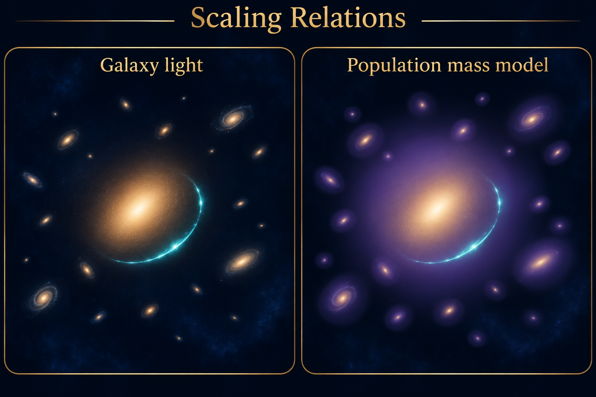 Scaling Relations</a></td></tr><tr><td width="25%"><a href="#multi-galaxy-lenses-groups-and-clusters">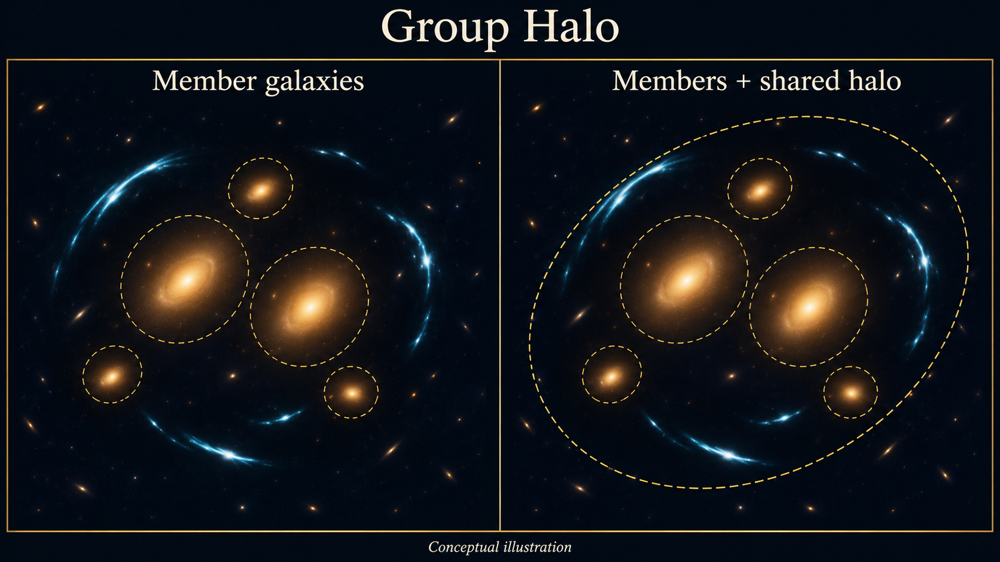 Multi-Galaxy Lenses, Groups and Clusters</a></td><td width="25%"><a href="#double-source-plane-lenses"> Double Source-Plane Lenses</a></td><td width="25%"><a href="#weak-lensing">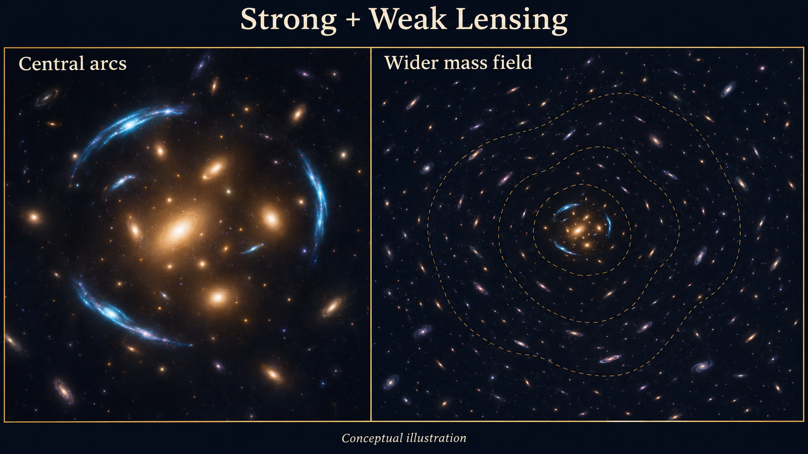 Weak Lensing</a></td><td width="25%"><a href="#line-of-sight-halos">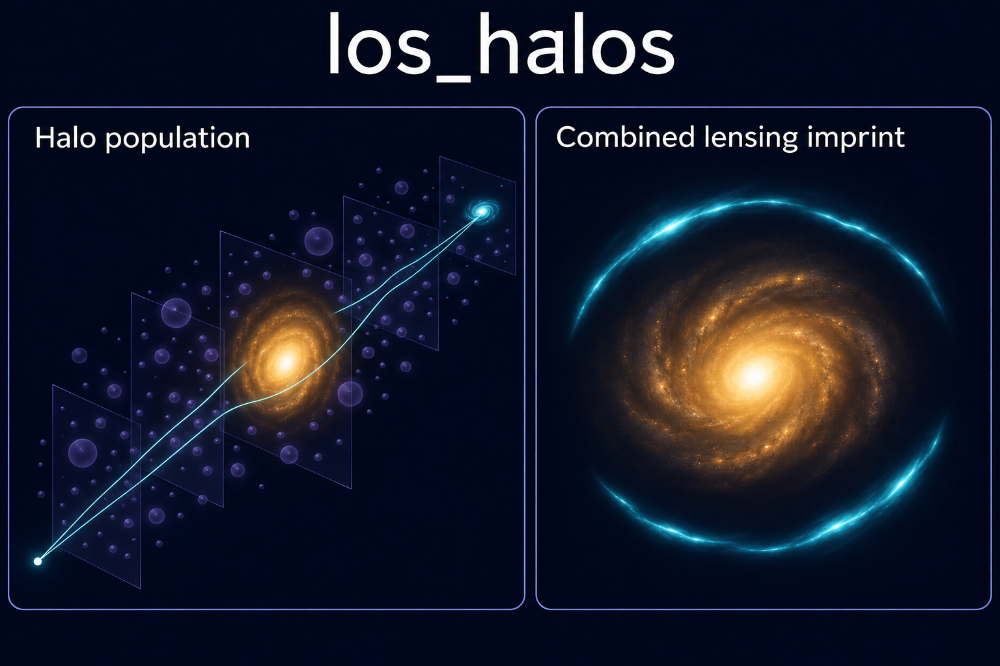 Line-of-Sight Halos</a></td></tr><tr><td width="25%"><a href="#potential-correction"> Potential Correction</a></td></tr></tbody></table>

## Reconstruct the source

<h3>Pixelizations</h3>
Reconstruct the background galaxy on a mesh to study spiral arms, star-forming clumps and irregular structure. Pixelization is a key tool for <strong>source science</strong>: measuring intrinsic flux, size and magnification alongside the lens mass.

<a href="https://github.com/PyAutoLabs/autolens_workspace/blob/main/notebooks/imaging/features/pixelization/start_here.ipynb">Start with pixelization</a>.

<h3>Multi Gaussian Expansion (MGE)</h3>
Model foreground lens light that overlaps the arcs, or reconstruct a flexible smooth source, using a sum of Gaussians. An MGE captures changes in shape with radius while solving component brightnesses together. Source examples include flux and magnification measurements.

<a href="https://github.com/PyAutoLabs/autolens_workspace/blob/main/notebooks/imaging/features/multi_gaussian_expansion/start_here.ipynb">Explore multi gaussian expansion (mge)</a>.

<h3>Shapelets</h3>
Study source morphology or flexible foreground light with a sum of spatial basis functions. Shapelets capture structure beyond a simple smooth profile while retaining a compact description of the basis geometry. Inspect the combined light and residuals as you increase flexibility.

<a href="https://github.com/PyAutoLabs/autolens_workspace/blob/main/notebooks/imaging/features/advanced/shapelets/start_here.ipynb">Explore shapelets</a>.

## Model foreground light and neighbours

<h3>Linear Light Profiles</h3>
Fit models with many light components using fewer sampled parameters. Component brightnesses are solved together at each likelihood evaluation, leaving the search to explore geometry and lens mass. Useful for lens light, source light and MGE models; solved brightnesses change with the model.

<a href="https://github.com/PyAutoLabs/autolens_workspace/blob/main/notebooks/imaging/features/linear_light_profiles/start_here.ipynb">Explore linear light profiles</a>.

<h3>Extra Galaxies</h3>
Account for neighbours whose light blends with the arcs or whose gravity changes the lensing. Choose a light model, mass model or both for each companion. Masking its emission does not remove its gravitational effect.

<a href="https://github.com/PyAutoLabs/autolens_workspace/blob/main/notebooks/imaging/features/extra_galaxies/start_here.ipynb">Explore extra galaxies</a>.

<h3>No Lens Light</h3>
Fit the lens mass and source when foreground light is negligible or has already been subtracted. The lens still deflects light. For subtracted images, check how residuals and subtraction uncertainty affect the result.

<a href="https://github.com/PyAutoLabs/autolens_workspace/blob/main/notebooks/imaging/features/no_lens_light/start_here.ipynb">Explore no lens light</a>.

<h3>Operated Light Profiles</h3>
Separate compact emission from extended galaxy light using a component that already includes the imaging PSF response. The surrounding galaxy still receives its appropriate instrumental response. Interferometer examples instead transform the compact sky emission into visibilities.

<a href="https://github.com/PyAutoLabs/autolens_workspace/blob/main/notebooks/imaging/features/advanced/operated_light_profile/start_here.ipynb">Explore operated light profiles</a>.

<h3>Sky Background</h3>
Fit an uncertain sky level alongside faint lens light and arcs. This helps distinguish galaxy outskirts from residual background, while keeping sky photon noise in the noise model. The example fits a constant level.

<a href="https://github.com/PyAutoLabs/autolens_workspace/blob/main/notebooks/imaging/features/advanced/sky_background/start_here.ipynb">Explore sky background</a>.

**Advanced: ellipse fitting.** Measure foreground-light shape with the [ellipse introduction](https://github.com/PyAutoLabs/autolens_workspace/blob/main/notebooks/imaging/features/advanced/ellipse/start_here.ipynb), then follow the maintained PyAutoGalaxy examples.

## Measure lens mass

<h3>Mass Models</h3>
Test how the assumed mass distribution affects the inferred lens and source. Choose total-mass profiles or separate stellar and dark components, and use multipoles to explore departures from elliptical symmetry. Angular structure can otherwise resemble a substructure signal.

<a href="https://github.com/PyAutoLabs/autolens_workspace/blob/main/notebooks/guides/profiles">Explore mass models</a>.

<h3>Stellar + Dark Matter</h3>
Measure how stars and dark matter contribute to a lens galaxy’s mass. Combine a stellar component tied to observed light with a separate halo to infer mass-to-light ratios and aperture masses. Lensing measures their combined gravity, so the split depends on the model and priors.

<a href="https://github.com/PyAutoLabs/autolens_workspace/blob/main/notebooks/imaging/features/advanced/mass_stellar_dark/start_here.ipynb">Explore stellar + dark matter</a>.

<h3>Scaling Relations</h3>
Include a population of companion galaxies without fitting every mass independently. Tie mass normalizations to measured luminosities through a shared relation, while giving influential companions more freedom. The tied masses depend on that population assumption.

<a href="https://github.com/PyAutoLabs/autolens_workspace/blob/main/notebooks/imaging/features/scaling_relation/start_here.ipynb">Explore scaling relations</a>.

<h3>Multi-Galaxy Lenses, Groups and Clusters</h3>
Model systems with several deflectors: <strong>multi-galaxy lenses</strong> have co-dominant galaxies; <strong>groups</strong> can include a shared halo; <strong>clusters</strong> use multiple-image positions from many sources. Choose the scale and observables that match your data.

<a href="https://github.com/PyAutoLabs/autolens_workspace/blob/main/notebooks/group/start_here.ipynb">Explore multi-galaxy lenses, groups and clusters</a>.

<h3>Double Source-Plane Lenses</h3>
Use two background galaxies at different redshifts to probe lens mass and reconstruct both sources. Their geometry can also constrain cosmological distance ratios. Multi-plane modelling includes the nearer source’s deflection of the farther one; the introductory fit keeps cosmology fixed.

<a href="https://github.com/PyAutoLabs/autolens_workspace/blob/main/notebooks/imaging/features/advanced/double_source_plane_lens/start_here.ipynb">Explore double source-plane lenses</a>.

<h3>Weak Lensing</h3>
Constrain mass across a wider field using the coherent shape distortions of background galaxies. Fit shear catalogues alone or combine them with central strong-lensing constraints, preserving each dataset’s uncertainties and source-redshift information.

<a href="https://github.com/PyAutoLabs/autolens_workspace/blob/main/notebooks/weak/start_here.ipynb">Explore weak lensing</a>.

## Probe dark matter and build analyses

<h3>Dark Matter Subhalos</h3>
Search for unseen halos through their perturbations to lensed arcs. Compare fits with and without a halo to identify candidates and infer their properties. Check candidates against lens-model flexibility and systematics, then use sensitivity mapping to interpret both detections and non-detections.

<a href="https://github.com/PyAutoLabs/autolens_workspace/blob/main/notebooks/imaging/features/advanced/subhalo/start_here.ipynb">Explore dark matter subhalos</a>.

Continue to <a href="https://github.com/PyAutoLabs/autolens_workspace/blob/main/notebooks/imaging/features/advanced/subhalo/detect/start_here.ipynb">subhalo detection</a> for the search workflow.

<h3>Line-of-Sight Halos</h3>
Simulate the combined effect of a halo population between observer and source. Multi-plane ray tracing includes halos in front of and behind the main lens, providing mock images for dark matter studies and tests of lens-redshift assumptions. These examples generate simulations, not population-inference results.

<a href="https://github.com/PyAutoLabs/autolens_workspace/blob/main/notebooks/imaging/features/advanced/los_halos/start_here.ipynb">Explore line-of-sight halos</a>.

<h3>Sensitivity Mapping</h3>
Measure which halos your data and modelling procedure could detect. Inject a halo into simulated data, fit with and without it, and repeat across positions or masses. This calibrates non-detections as well as detections; the introductory example uses four positions at one injected mass.

<a href="https://github.com/PyAutoLabs/autolens_workspace/blob/main/notebooks/imaging/features/advanced/subhalo/sensitivity/start_here.ipynb">Explore sensitivity mapping</a>.

<h3>Potential Correction</h3>
Investigate arc residuals by reconstructing small corrections to a smooth lensing potential alongside the source. This gravitational-imaging approach locates candidate mass structure without first choosing a halo profile. A reconstructed feature still needs physical modelling and systematic checks.

<a href="https://github.com/PyAutoLabs/autolens_workspace/blob/main/notebooks/imaging/features/advanced/potential_correction/start_here.ipynb">Explore potential correction</a>.

<h3>Automated Pipelines / SLaM</h3>
Build complex lens models through a sequence of simpler fits. The Source, Light and Mass pipelines use earlier results to initialize later searches, progressively refining the source, foreground light and mass model.

<a href="https://github.com/PyAutoLabs/autolens_workspace/blob/main/notebooks/guides/modeling/slam_start_here.ipynb">Explore automated pipelines / slam</a>.

<h3>Graphical Models</h3>
Study populations of lenses by fitting datasets with shared parameters. Hierarchical models infer a population distribution while retaining an individual model for each lens—for example, a distribution of mass slopes or a common Hubble constant.

<a href="https://github.com/PyAutoLabs/autolens_workspace/blob/main/notebooks/guides/modeling/advanced/graphical.ipynb">Explore graphical models</a>.

## Extend the analysis across observations

<h3>Point Sources</h3>
Add flux and time-delay constraints to a point-source lens model, or deblend compact images from foreground light before measuring them.

<a href="https://github.com/PyAutoLabs/autolens_workspace/blob/main/notebooks/point_source/start_here.ipynb">Point-source examples</a>.

<h3>Interferometry</h3>
Extend radio and submillimetre modelling with flexible source light, pixelized reconstructions and source-science measurements while fitting the visibilities.

<a href="https://github.com/PyAutoLabs/autolens_workspace/tree/main/notebooks/interferometer/features">Interferometer features</a>.

<h3>Data Cubes</h3>
Map a lensed source across a spectral line by reconstructing each channel with a shared lens model. Each channel keeps its own brightness, sampling and noise. These examples reconstruct emission; a dynamical interpretation needs an additional model.

<a href="https://github.com/PyAutoLabs/autolens_workspace/blob/main/notebooks/interferometer/features/datacube/start_here.ipynb">Explore data cubes</a>.

<h3>Multi-Wavelength</h3>
Compare stellar, dust and line emission across observations while fitting a shared lens model. Keep each dataset’s brightness distribution, instrumental response and noise distinct; link only the parameters your scientific model shares.

<a href="https://github.com/PyAutoLabs/autolens_workspace/blob/main/notebooks/multi_dataset/start_here.ipynb">Explore multi-wavelength</a>.

<section class="directory" id="directory"><h2>All workspace links</h2>
Choose your dataset to browse every feature introduction.

Group · 13 introductions
<ul><li><a href="https://github.com/PyAutoLabs/autolens_workspace/blob/main/notebooks/group/features/advanced/double_source_plane_lens/start_here.ipynb">Double Source Plane Lens</a></li><li><a href="https://github.com/PyAutoLabs/autolens_workspace/blob/main/notebooks/group/features/advanced/mass_stellar_dark/start_here.ipynb">Mass Stellar Dark</a></li><li><a href="https://github.com/PyAutoLabs/autolens_workspace/blob/main/notebooks/group/features/advanced/operated_light_profile/start_here.ipynb">Operated Light Profile</a></li><li><a href="https://github.com/PyAutoLabs/autolens_workspace/blob/main/notebooks/group/features/advanced/shapelets/start_here.ipynb">Shapelets</a></li><li><a href="https://github.com/PyAutoLabs/autolens_workspace/blob/main/notebooks/group/features/advanced/sky_background/start_here.ipynb">Sky Background</a></li><li><a href="https://github.com/PyAutoLabs/autolens_workspace/blob/main/notebooks/group/features/advanced/subhalo/detect/start_here.ipynb">Subhalo / Detect</a></li><li><a href="https://github.com/PyAutoLabs/autolens_workspace/blob/main/notebooks/group/features/advanced/subhalo/start_here.ipynb">Subhalo</a></li><li><a href="https://github.com/PyAutoLabs/autolens_workspace/blob/main/notebooks/group/features/group_halo/start_here.ipynb">Group Halo</a></li><li><a href="https://github.com/PyAutoLabs/autolens_workspace/blob/main/notebooks/group/features/linear_light_profiles/start_here.ipynb">Linear Light Profiles</a></li><li><a href="https://github.com/PyAutoLabs/autolens_workspace/blob/main/notebooks/group/features/multi_gaussian_expansion/start_here.ipynb">Multi Gaussian Expansion</a></li><li><a href="https://github.com/PyAutoLabs/autolens_workspace/blob/main/notebooks/group/features/no_lens_light/start_here.ipynb">No Lens Light</a></li><li><a href="https://github.com/PyAutoLabs/autolens_workspace/blob/main/notebooks/group/features/pixelization/start_here.ipynb">Pixelization</a></li><li><a href="https://github.com/PyAutoLabs/autolens_workspace/blob/main/notebooks/group/features/scaling_relation/start_here.ipynb">Scaling Relation</a></li></ul>

Imaging · 17 introductions
<ul><li><a href="https://github.com/PyAutoLabs/autolens_workspace/blob/main/notebooks/imaging/features/advanced/double_source_plane_lens/start_here.ipynb">Double Source Plane Lens</a></li><li><a href="https://github.com/PyAutoLabs/autolens_workspace/blob/main/notebooks/imaging/features/advanced/ellipse/start_here.ipynb">Ellipse</a></li><li><a href="https://github.com/PyAutoLabs/autolens_workspace/blob/main/notebooks/imaging/features/advanced/los_halos/start_here.ipynb">Los Halos</a></li><li><a href="https://github.com/PyAutoLabs/autolens_workspace/blob/main/notebooks/imaging/features/advanced/mass_stellar_dark/start_here.ipynb">Mass Stellar Dark</a></li><li><a href="https://github.com/PyAutoLabs/autolens_workspace/blob/main/notebooks/imaging/features/advanced/operated_light_profile/start_here.ipynb">Operated Light Profile</a></li><li><a href="https://github.com/PyAutoLabs/autolens_workspace/blob/main/notebooks/imaging/features/advanced/potential_correction/start_here.ipynb">Potential Correction</a></li><li><a href="https://github.com/PyAutoLabs/autolens_workspace/blob/main/notebooks/imaging/features/advanced/shapelets/start_here.ipynb">Shapelets</a></li><li><a href="https://github.com/PyAutoLabs/autolens_workspace/blob/main/notebooks/imaging/features/advanced/sky_background/start_here.ipynb">Sky Background</a></li><li><a href="https://github.com/PyAutoLabs/autolens_workspace/blob/main/notebooks/imaging/features/advanced/subhalo/detect/start_here.ipynb">Subhalo / Detect</a></li><li><a href="https://github.com/PyAutoLabs/autolens_workspace/blob/main/notebooks/imaging/features/advanced/subhalo/sensitivity/start_here.ipynb">Subhalo / Sensitivity</a></li><li><a href="https://github.com/PyAutoLabs/autolens_workspace/blob/main/notebooks/imaging/features/advanced/subhalo/start_here.ipynb">Subhalo</a></li><li><a href="https://github.com/PyAutoLabs/autolens_workspace/blob/main/notebooks/imaging/features/extra_galaxies/start_here.ipynb">Extra Galaxies</a></li><li><a href="https://github.com/PyAutoLabs/autolens_workspace/blob/main/notebooks/imaging/features/linear_light_profiles/start_here.ipynb">Linear Light Profiles</a></li><li><a href="https://github.com/PyAutoLabs/autolens_workspace/blob/main/notebooks/imaging/features/multi_gaussian_expansion/start_here.ipynb">Multi Gaussian Expansion</a></li><li><a href="https://github.com/PyAutoLabs/autolens_workspace/blob/main/notebooks/imaging/features/no_lens_light/start_here.ipynb">No Lens Light</a></li><li><a href="https://github.com/PyAutoLabs/autolens_workspace/blob/main/notebooks/imaging/features/pixelization/start_here.ipynb">Pixelization</a></li><li><a href="https://github.com/PyAutoLabs/autolens_workspace/blob/main/notebooks/imaging/features/scaling_relation/start_here.ipynb">Scaling Relation</a></li></ul>

Interferometer · 12 introductions
<ul><li><a href="https://github.com/PyAutoLabs/autolens_workspace/blob/main/notebooks/interferometer/features/advanced/operated_light_profile/start_here.ipynb">Operated Light Profile</a></li><li><a href="https://github.com/PyAutoLabs/autolens_workspace/blob/main/notebooks/interferometer/features/advanced/potential_correction/start_here.ipynb">Potential Correction</a></li><li><a href="https://github.com/PyAutoLabs/autolens_workspace/blob/main/notebooks/interferometer/features/advanced/shapelets/start_here.ipynb">Shapelets</a></li><li><a href="https://github.com/PyAutoLabs/autolens_workspace/blob/main/notebooks/interferometer/features/advanced/subhalo/detect/start_here.ipynb">Subhalo / Detect</a></li><li><a href="https://github.com/PyAutoLabs/autolens_workspace/blob/main/notebooks/interferometer/features/advanced/subhalo/sensitivity/start_here.ipynb">Subhalo / Sensitivity</a></li><li><a href="https://github.com/PyAutoLabs/autolens_workspace/blob/main/notebooks/interferometer/features/advanced/subhalo/start_here.ipynb">Subhalo</a></li><li><a href="https://github.com/PyAutoLabs/autolens_workspace/blob/main/notebooks/interferometer/features/datacube/start_here.ipynb">Datacube</a></li><li><a href="https://github.com/PyAutoLabs/autolens_workspace/blob/main/notebooks/interferometer/features/extra_galaxies/start_here.ipynb">Extra Galaxies</a></li><li><a href="https://github.com/PyAutoLabs/autolens_workspace/blob/main/notebooks/interferometer/features/linear_light_profiles/start_here.ipynb">Linear Light Profiles</a></li><li><a href="https://github.com/PyAutoLabs/autolens_workspace/blob/main/notebooks/interferometer/features/multi_gaussian_expansion/start_here.ipynb">Multi Gaussian Expansion</a></li><li><a href="https://github.com/PyAutoLabs/autolens_workspace/blob/main/notebooks/interferometer/features/pixelization/start_here.ipynb">Pixelization</a></li><li><a href="https://github.com/PyAutoLabs/autolens_workspace/blob/main/notebooks/interferometer/features/scaling_relation/start_here.ipynb">Scaling Relation</a></li></ul>

Multi dataset · 8 introductions
<ul><li><a href="https://github.com/PyAutoLabs/autolens_workspace/blob/main/notebooks/multi_dataset/features/dataset_offsets/start_here.ipynb">Dataset Offsets</a></li><li><a href="https://github.com/PyAutoLabs/autolens_workspace/blob/main/notebooks/multi_dataset/features/imaging_and_interferometer/start_here.ipynb">Imaging And Interferometer</a></li><li><a href="https://github.com/PyAutoLabs/autolens_workspace/blob/main/notebooks/multi_dataset/features/imaging_and_point_source/start_here.ipynb">Imaging And Point Source</a></li><li><a href="https://github.com/PyAutoLabs/autolens_workspace/blob/main/notebooks/multi_dataset/features/one_by_one/start_here.ipynb">One By One</a></li><li><a href="https://github.com/PyAutoLabs/autolens_workspace/blob/main/notebooks/multi_dataset/features/pixelization/start_here.ipynb">Pixelization</a></li><li><a href="https://github.com/PyAutoLabs/autolens_workspace/blob/main/notebooks/multi_dataset/features/same_wavelength/start_here.ipynb">Same Wavelength</a></li><li><a href="https://github.com/PyAutoLabs/autolens_workspace/blob/main/notebooks/multi_dataset/features/slam/start_here.ipynb">Slam</a></li><li><a href="https://github.com/PyAutoLabs/autolens_workspace/blob/main/notebooks/multi_dataset/features/wavelength_dependence/start_here.ipynb">Wavelength Dependence</a></li></ul>

Multi galaxy · 13 introductions
<ul><li><a href="https://github.com/PyAutoLabs/autolens_workspace/blob/main/notebooks/multi_galaxy/features/advanced/double_source_plane_lens/start_here.ipynb">Double Source Plane Lens</a></li><li><a href="https://github.com/PyAutoLabs/autolens_workspace/blob/main/notebooks/multi_galaxy/features/advanced/mass_stellar_dark/start_here.ipynb">Mass Stellar Dark</a></li><li><a href="https://github.com/PyAutoLabs/autolens_workspace/blob/main/notebooks/multi_galaxy/features/advanced/operated_light_profile/start_here.ipynb">Operated Light Profile</a></li><li><a href="https://github.com/PyAutoLabs/autolens_workspace/blob/main/notebooks/multi_galaxy/features/advanced/shapelets/start_here.ipynb">Shapelets</a></li><li><a href="https://github.com/PyAutoLabs/autolens_workspace/blob/main/notebooks/multi_galaxy/features/advanced/sky_background/start_here.ipynb">Sky Background</a></li><li><a href="https://github.com/PyAutoLabs/autolens_workspace/blob/main/notebooks/multi_galaxy/features/advanced/subhalo/detect/start_here.ipynb">Subhalo / Detect</a></li><li><a href="https://github.com/PyAutoLabs/autolens_workspace/blob/main/notebooks/multi_galaxy/features/advanced/subhalo/start_here.ipynb">Subhalo</a></li><li><a href="https://github.com/PyAutoLabs/autolens_workspace/blob/main/notebooks/multi_galaxy/features/extra_galaxies/start_here.ipynb">Extra Galaxies</a></li><li><a href="https://github.com/PyAutoLabs/autolens_workspace/blob/main/notebooks/multi_galaxy/features/linear_light_profiles/start_here.ipynb">Linear Light Profiles</a></li><li><a href="https://github.com/PyAutoLabs/autolens_workspace/blob/main/notebooks/multi_galaxy/features/multi_gaussian_expansion/start_here.ipynb">Multi Gaussian Expansion</a></li><li><a href="https://github.com/PyAutoLabs/autolens_workspace/blob/main/notebooks/multi_galaxy/features/no_lens_light/start_here.ipynb">No Lens Light</a></li><li><a href="https://github.com/PyAutoLabs/autolens_workspace/blob/main/notebooks/multi_galaxy/features/pixelization/start_here.ipynb">Pixelization</a></li><li><a href="https://github.com/PyAutoLabs/autolens_workspace/blob/main/notebooks/multi_galaxy/features/scaling_relation/start_here.ipynb">Scaling Relation</a></li></ul>

Point source · 4 introductions
<ul><li><a href="https://github.com/PyAutoLabs/autolens_workspace/blob/main/notebooks/point_source/features/deblending/start_here.ipynb">Deblending</a></li><li><a href="https://github.com/PyAutoLabs/autolens_workspace/blob/main/notebooks/point_source/features/extra_galaxies/start_here.ipynb">Extra Galaxies</a></li><li><a href="https://github.com/PyAutoLabs/autolens_workspace/blob/main/notebooks/point_source/features/multiple_sources/start_here.ipynb">Multiple Sources</a></li><li><a href="https://github.com/PyAutoLabs/autolens_workspace/blob/main/notebooks/point_source/features/scaling_relation/start_here.ipynb">Scaling Relation</a></li></ul>

Weak · 1 introductions
<ul><li><a href="https://github.com/PyAutoLabs/autolens_workspace/blob/main/notebooks/weak/features/strong_lensing/start_here.ipynb">Strong Lensing</a></li></ul>
</section>